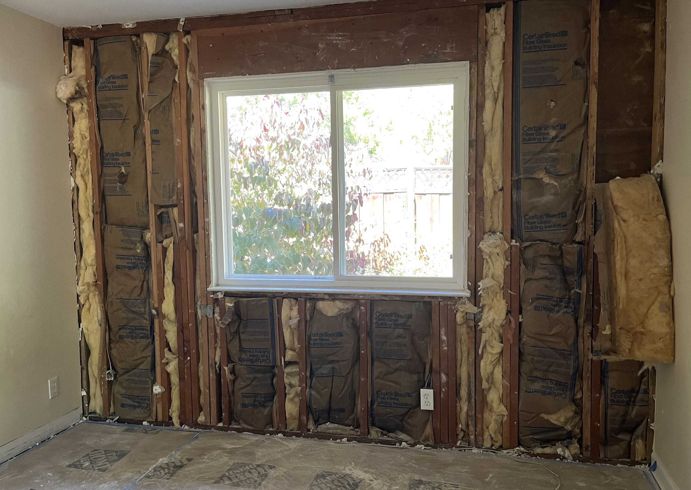
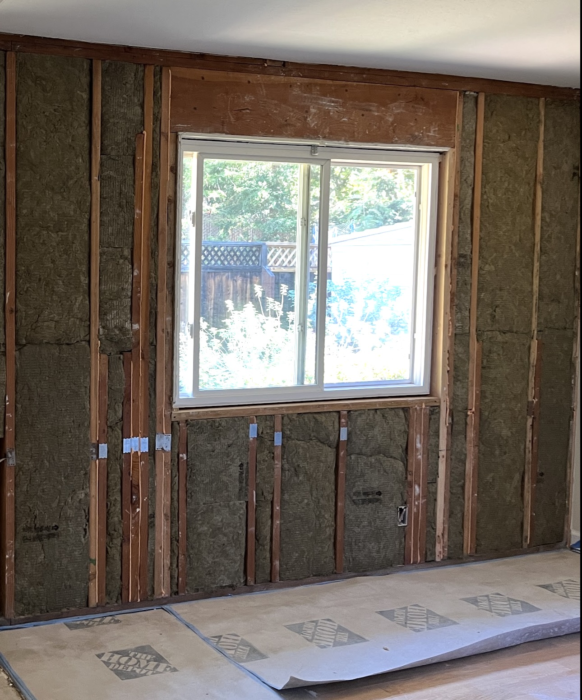

집을 고칠 때 사람마다 중요하게 생각하는 포인트가 다를 것이다. 한정된 버짓안에서 내가 원하는 것들을 고치려고 했을 때 나는 우선 순위를 어디에 둘까 고민했다.
난 채광, 단열, 환기를 중요하게 생각한다.

북캘리포니아의 1960-70년대에 지어진 내가 살아본 싱글 패밀리 하우스들은 봄, 가을, 겨울 낮에 집안이 집밖보다 추운 신기한 공간이었다.(전기 가스값을 절약하려고 히터를 최소한으로 튼 나의 생활습관 탓도 있다.) 
혹독한 겨울의 추위가 없어 집밖의 햇빛 비치는 곳은 겨울에도 저렇게 온화한데 왜 그 햇볕의 온기가 집안에는 미치지 않는지 미스테리다. 암튼 나는 이것을 부실한 단열탓으로 자가 진단을 하고 새로 이사가는 집은 이사가기 전에 기필코 단열재를 잘 넣으리라고 결심했다. 

**알게된 사실:** 
여러가지 시공 방법이 있는데 내가 선택한 방법은 외부로 면한 내벽의 드라이월을 모두 뜯고 오래된 부실한 단열재를 제거한 뒤 최대한 단열이 잘되는 단열재를 다시 넣고 드라이월을 다시 걸고 텍스처, 페인트 마감을 하는 것이었다. 이 공사를 하려면 드라이월 컨트랙터, 인슐레이션 컨트랙터를 구하면 된다.

제너럴 컨트랙터를 구해서 종합 선물세트처럼 전체 리모델링을 할 경우, 제너럴 컨트랙터가 알아서 시공해줄 수 있지만, 
내가 알아봤던 봐로는 제너럴 컨트랙터도 서브 컨트랙터로 인슐레이션 컴퍼니를 고용해서 단열재 시공하는 게 그들이 직접하는 것 대비 비용이 훨씬 싸서 그렇게 한다고 했다. 인슐레이션 컴퍼니는 거의 일반인이 홈디포에서 사는 재료값으로 재료+시공까지 해주는 금액으로 일한다.

우리가 고치는 집은 캘리포니아 60년대에 지어진 옛날집이라 스터드가 2x4이다. 즉 벽 두께가 얇아서 그 안에 단열재를 채워넣을 수 있는 공간도 얇다. 요즘 지어지는 새집들은 2x6 스터드이고 더 두꺼운 R vaule가 높은 효과좋은 단열재를 넣는다는데 우리에게는 2x4에 맞게 최대로 넣을 수 있는 단열재는 R15였다.
내가 알아본 단열재는 파이버글래스, 미네랄울, 스프레이폼이 있었고, 가장 맘에 드는 것은 미네랄울이었다. 셋중에 파이버글래스가 가장 가격이 저렴한데 왜 난 미네랄울에 꽂힌 것인지는 잘 모르겠다. 

암튼 파이버글래스 R15로 할 경우 미네랄울 R15로 하는 것과 거의 유사하게 단열효과를 얻을 수 있다고 했다. 
파이버글래스는 미네랄울에 비해 조직이 덜 치밀해서 시간이 지나면 중력에 의해 가라앉을 수도 있다는 단점을 인터넷에서 봐서 나의 이 우려를 인술레이션 컨트랙터에게 말했더니 R11, R13은 그럴 수 있는데 R15만 되도 몇십년동안은 가라앉을 것을 걱정할 필요는 없다는 답변을 들었다. 

미네랄울로 할 경우 파이버글래스에 비해 재료값이 조금 더 들기는 하지만, 습기에 더 강하고 방음효과(사운드 인술레이션)는 파이버글래스 단열재에 비해 탁월하다고 한다. 우리는 집에서 하는 악기 연습이 옆집에 방해되지 않는 게 중요해서 미네랄울로 최종 결정했다.

**진행시 어려웠던 점:**
누구에게 벽단열재 시공을 맡길 것인가.

공사를 시작하기 한참 전인 5월, 지식이 별로 없었을 때는, 화장실 공사를 맡기기로 한 타일 컨트랙터가 자기가 단열재 시공도 할 수 있다는 말을 하길래 (다른 업체를 또 알아보려면 귀찮으니) 그냥 그 컨트랙터에게 맡기려고 단순하게 생각하고 견적을 받고 구두로 합의를 해두었다. 볼티드 실링덱에 필요한 스프레이폼 단열은 단열 라이센스를 가진 컨트랙터만 할 수 있으므로, 프레이밍 컨트랙터가 소개해준 인술레이션 컴퍼니에게 별도로 견적을 받고 서면 계약해두었다. 그 컴퍼니에게 벽단열 견적도 받기는 했는데, 미네랄울 수급이 어려워 파이버글래스로 벽단열 시공만 가능하다고 했다. 

미네랄울 재료 수급이 어렵다는 사실을 알게 된 후 걱정이 되어 단열 서플라이 업체에 전화해보니 요즘 재고 수량이 많지 많아 자기네들과 거래하던 인술레이션 컨트랙터들에게만 한정 판매한다고 했고, 내가 5월에 구두 계약한 컨트랙터는 미네랄울을 좋은 가격에 확보할 수 없는 상황이었다. 안타깝지만 이 컨트랙터에게 벽단열을 맡기는 것을 취소하기로 했다. 

러프 인스펙션을 마치면 이제 곧 단열 시공 단계가 되는데 아직도 단열 시공 업자를 확정하지 못해 나는 속이 탔다. 내 프로젝트 조건에는 씨티에서 진행하는 러프 인스펙션을 하기 전 스페셜 인스펙션으로 구조 확인을 먼저 받아야 했고, 그 스페셜 인스펙션을 스님같은 스트럭처 엔지니어에게 요청했다. 대충 5분도 안되게 쓰윽 보더니 통과. 비싸게 돈내고 스페셜 인스펙션하는데 저렇게 짧게 대충 보다니.. 스페셜 인스펙션 비용이 아깝다는 생각과 본전을 조금이라도 건지고 싶다는 마음으로 이번에도 지푸라기 잡는 심정으로 이 스님에게 추가 질문을 했다. 벽단열을 미네랄울로 하고 싶은데 시공 업체를 못구하고 있다. 추천해줄 사람이 있는지.. 그랬더니 스님이 예전에 프로젝트할 때 써본 업체가 괜찮았다며 연락처를 알려줬다. 

스님의 추천 업체는 미네랄울도 구할 수 있었고 스프레이폼 천장 단열도 할 수 있었고 가격도 나쁘지 않고, 커뮤니케이션도 신속 명확했다. 문제는 난 이미 프레이밍 컨트랙터가 소개해준 인술레이션 컴퍼니에 스프레이폼 천장 단열은 계약을 해둔 상태. 그쪽 계약을 쉽게 취소할 수 있으면 이 업체에 모두 맡기는 게 베스트였고, 그 다른 업체에서 계약 취소가 불가하다면 스님 소개 업체에는 벽단열만 맡기는 것으로 해야겠다고 마음 먹었다. 단열 일을 두 업체에서 하게 되면 번거롭기는 한데 정 안되면 그렇게라도 진행하는 수밖에..

떨리는 마음으로 프레이밍 컨트랙터 소개 단열 업체 세일즈 아저씨에게 조심스럽게 문자로 질문을 보냈다. 혹시 지금은 미네랄울 조달 사정이 나아졌는지, 아니라면 천장 스프레이 폼 단열 계약을 취소할 수 있는지, 취소시 벌금이 있는지 등등. 잠시후 세일즈 아저씨가 나에게 전화를 했고, 나의 자초지종을 들은 뒤 기분나쁜 내색 없이 흔쾌히 취소해줬다. 정말 고마웠다. 

중요하게 생각하는 단열을 원하는 재료로 시공하기 위해 여러 가지 맘고생을 좀 했지만 결국 원하는 대로 하게 되서 매우 기쁜 순간이었다. 이사 들어간 후에 히터를 조금만 틀어도 집안 온기가 잘 유지되고 만족스럽다고 느낄 수 있게 되기를 바란다.

추천하는 인술레이션 컴퍼니 정보: [insultechs.com](https://insultechs.com)

*인술레이션 시공 전 사진: 부실한 단열재가 들어있던 상태*

*인술레이션 시공 후 사진: 치밀한 미네랄울 단열재로 교체*

